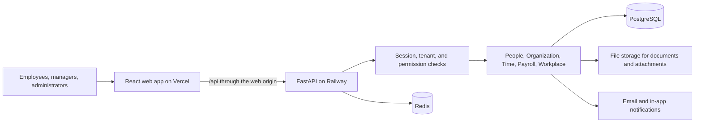

# System design

Talvynza uses a modular FastAPI backend and a React web client. One deployment hosts the API modules. PostgreSQL holds the authoritative HR records, and each request resolves the active organization before a module reads or writes tenant data.

## Responsibilities

| Area | Owns |
| --- | --- |
| Identity and tenancy | Sessions, organization membership, roles, permissions, invitations, and audit records |
| Organization | Branches, branch premises, departments, designations, and holidays |
| People and recruitment | Employee records, placement history, onboarding, candidate conversion, and exits |
| Time | Attendance events, workday summaries, shifts, leave balances, and request decisions |
| Payroll | Salary templates and revisions, payroll runs, employee entries, and published payslips |
| Workplace | Tasks, performance, training, assets, expenses, loans, notices, and help desk tickets |

The employee record connects the operational modules. Its current placement links it to a branch, department, designation, and reporting manager. Effective-dated placement records preserve changes. Attendance consumes the employee's settings, branch premises, and shift. Payroll uses salary revisions and attendance or leave inputs for the pay period. The request inbox reads the underlying modules and sends decisions to the module that owns each record.

## Request and data boundaries

1. The browser sends requests through its web origin. Mutations include a CSRF token.
2. The API resolves the session, active organization, and membership permissions.
3. The module validates the requested action, record ownership or reporting scope, and business rules.
4. The module saves the result. Workflows that affect other modules publish updates through shared records, audit events, or notifications.
5. The browser refreshes related views and keeps navigation filters scoped to the signed-in account and organization.

See [security and privacy](security-privacy.md), the [entity relationships](../database/erd.md), and the [workflow diagrams](../product/workflows.md).

## Production and release

The Vercel web build serves the client routes and forwards API traffic to Railway. The Railway API container runs Alembic before accepting requests. PostgreSQL stores HR data, while Redis supports infrastructure tasks such as rate limiting. The Docker Compose stack provides a separate local deployment path.

1. Run API tests, web tests, the production build, and browser workflows.
2. Push the reviewed release commit to GitHub.
3. Deploy the API first when a release adds schema changes. Verify that migrations finished and the readiness endpoint responds.
4. Deploy the web build and verify the public entry point, a direct client route, and the API proxy.
5. Publish the GitHub release with the version tag and a product-facing title.
