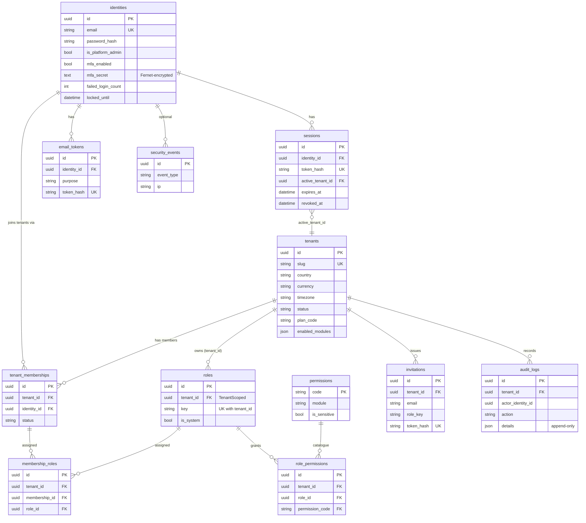
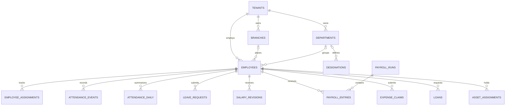

# Database ERD

The first diagram shows organization access. The second summarizes the records that connect placement,
attendance, leave, payroll, and workplace workflows. See the Alembic migrations for exact columns and constraints.

## Access and tenancy

## HR domains (migration 0002)

```mermaid
erDiagram
    tenants ||--o{ branches : has
    tenants ||--o{ departments : has
    departments ||--o{ designations : has
    departments ||--o{ departments : "parent_id"
    tenants ||--o{ employees : has
    tenant_memberships ||--o| employees : "optional login"
    employees ||--o{ employees : "manager_id"
    employees ||--o{ employee_assignments : "placement history"
    employees ||--o{ employee_lifecycle_events : has
    employees ||--o{ employee_education : has
    employees ||--o{ employee_documents : has
    employees ||--o{ employee_checklist_items : has
    employees ||--o{ attendance_events : punches
    employees ||--o{ attendance_daily : "derived summary"
    employees ||--o{ attendance_adjustments : corrections
    shifts ||--o{ shift_assignments : "assigned to"
    employees ||--o{ shift_assignments : has
    leave_types ||--o{ leave_ledger : "balance source"
    employees ||--o{ leave_ledger : has
    employees ||--o{ leave_requests : files
    leave_requests ||--o{ leave_ledger : "reserve, release, use"
    employees ||--o{ salary_revisions : "never overwritten"
    salary_revisions ||--o{ salary_revision_lines : has
    salary_components ||--o{ salary_revision_lines : used
    payroll_runs ||--o{ payroll_entries : has
    employees ||--o{ payroll_entries : paid
    payroll_entries ||--o{ payroll_line_items : breakdown
    jobs ||--o{ job_applications : receives
    candidates ||--o{ job_applications : makes
    job_applications ||--o{ interview_records : has
    tenant_memberships ||--o{ notifications : receives
    employees ||--o{ tasks : assigned
```

Notes: `attendance_events` are immutable punches and `attendance_daily` is recalculated from them. `leave_ledger` is
append-only and balances are always derived from it. Payroll entries and line items cannot be modified once the run
is approved. Money columns are `NUMERIC(14,2)`. Dates without a time zone (joining date, work date, leave dates) are
`DATE`. Instants are UTC `timestamptz`.

## Conventions
* UUID primary keys; constraint names follow the metadata naming convention (`ix_`, `uq_`, `fk_`, `pk_`).
* `TenantScoped` tables carry `tenant_id` (NOT NULL, FK, indexed) and are filtered automatically by the ORM layer.
* Timestamps are UTC instants (`timestamptz`); money will use `NUMERIC(18,2)` (never float).
* `audit_logs` is append-only (ORM update/delete raises). `security_events` is platform-level, not tenant-scoped.
* `tenants`, `tenant_memberships`, `identities` and `permissions` are intentionally not auto-scoped (see ARCHITECTURE §2).

## Employee and operational records

A branch stores its premises as named circular boundaries. Employee attendance settings separately control
web, mobile, and biometric access. Historical employee data can have an empty placement. New employees
require an active branch and department.
