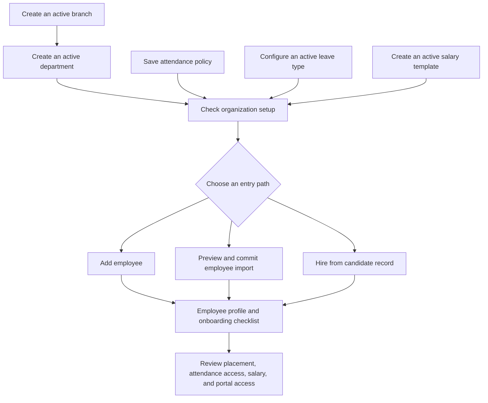
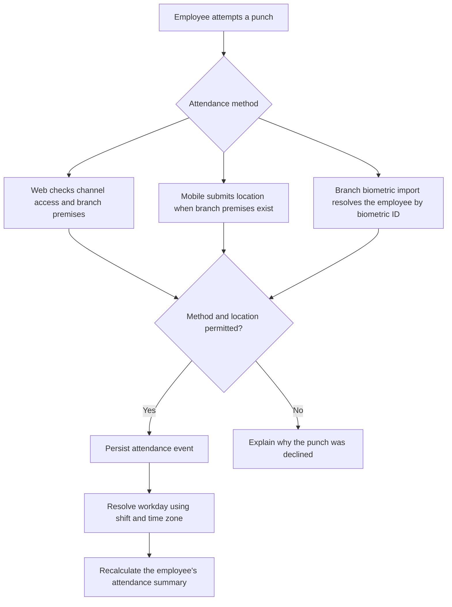
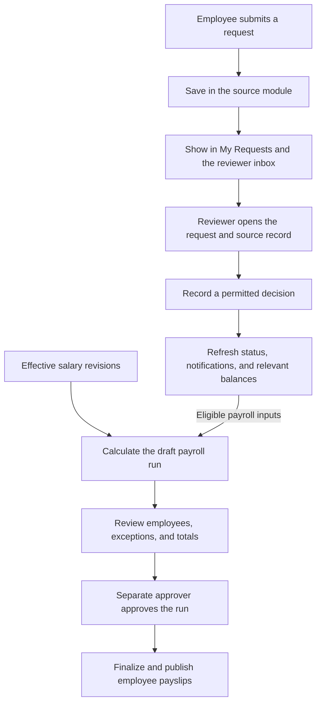
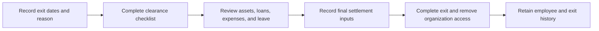

# Product workflows

## Organization setup and onboarding

New employees require an active branch and department. Department designation choices follow the selected department. The employee profile links placement with attendance, leave, payroll, and onboarding records.

## Attendance and branch premises

Web attendance is blocked when the branch has premises. Mobile can punch anywhere when enabled and the branch has no premises. Administrators can change one attendance method for a selection of employees using branch and department filters.

## Requests and payroll

Payroll finalization also settles expense claims and loan installments included in that run. Each payroll entry links to the corresponding employee record when the reviewer has access.

## Employee exit

The exit record links directly to the employee's assets, loans, expenses, and payslips. Outstanding assigned assets, loan balances, and clearance items block completion.
